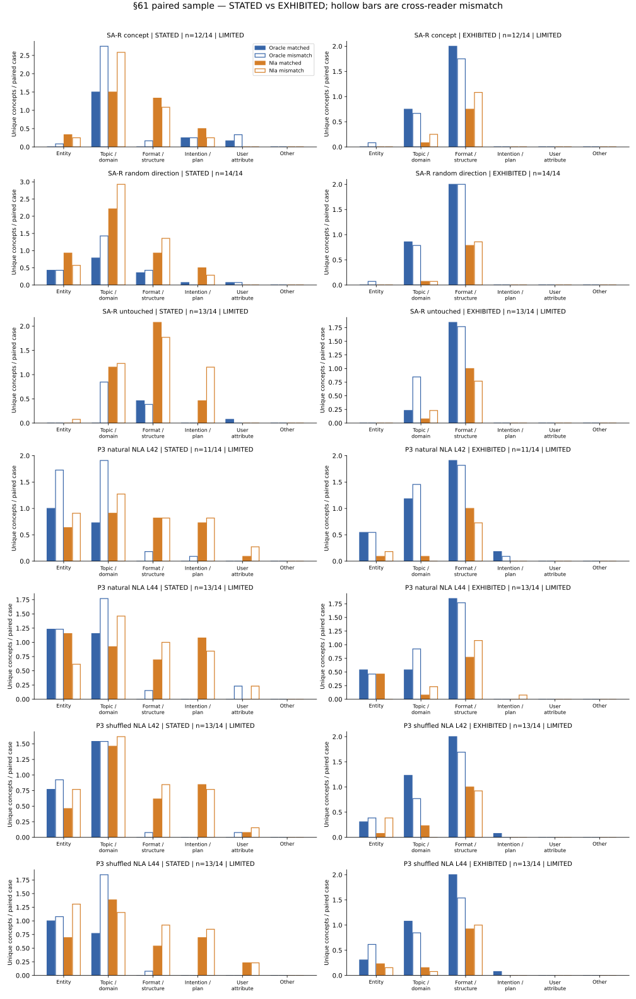

# §61 — reader-unique content and J-space grounding

**Part A now reports STATED and EXHIBITED separately, under the delivered amendment registered as `cb92c4fc`. Part C is cancelled.** Part B remains unchanged.

**Extraction-based counting under-credits continuation-style readers such as the Oracle lens.** A continuation can demonstrate language, code, style or content without naming those properties. The combined judge scores both modes on the same blinded pairs; neither measures whether a claim is true of a hidden state.

## Part A: frozen combined sample

On the common available sample, NLA has more STATED-only concepts and Oracle has more EXHIBITED-only concepts in every stratum. Six of seven strata are extraction-limited; these are descriptive sampled counts, not population rankings or evidence that the concepts are state-grounded. The mismatched-state comparison also contains substantial exhibited content.

98 cases, 14 per stratum; 190 deduplicated payloads cover 196 paired comparisons. 181 valid extractions, 9 MISSING. Counts use common matched/mismatched available cases; no extrapolation to all items. Detailed category/overlap counts, missing flags and the figure are in the [combined report](g38_combined_20261022/RESULTS.md).

| Population | STATED Oracle-only / NLA-only / both | EXHIBITED Oracle-only / NLA-only / both | Available / sampled | Limited |
|---|---:|---:|---:|---|
| SA-R concept | 23 / 44 / 27 | 33 / 10 / 3 | 12/14 | YES |
| SA-R random direction | 24 / 64 / 15 | 40 / 12 / 3 | 14/14 | No |
| SA-R untouched | 7 / 48 / 16 | 27 / 14 / 12 | 13/14 | YES |
| P3 natural NLA L42 | 19 / 35 / 26 | 42 / 13 / 3 | 11/14 | YES |
| P3 natural NLA L44 | 31 / 50 / 20 | 38 / 17 / 1 | 13/14 | YES |
| P3 shuffled NLA L42 | 30 / 45 / 16 | 47 / 17 / 1 | 13/14 | YES |
| P3 shuffled NLA L44 | 23 / 46 / 24 | 45 / 17 / 1 | 13/14 | YES |

## Part B: registered descriptive J-space split

The SA prediction went in the opposite direction: below-median NLA claims had higher whitened FVE (mean 0.006529 vs 0.000995) and higher FOUNDED rate (77.42% vs 57.45%; difference +19.97 pp, 95% clustered CI [4.67, 34.85]). These are relative median groups, not majority-of-energy labels. k=128, J44 primary, J42 cross-layer sensitivity; historical §58 outcomes had been seen before §61 registration.

P3 quote-conditional false-alarm rates were lower below the median: natural NLA L42 36.02% vs 65.04%, NLA L44 35.19% vs 66.22%; same direction under shuffled inputs. 6489/8000 eligible quoted-attribution units; 1511 unassigned. [Full Part B report and intervals](PART_B.md).

## Provenance and budgets

Combined-run reported usage $0.75655050; new retained $4.271649525; prior retained $5.239650974 unchanged; aggregate retained $9.511300499 under $10. Cumulative reported usage $1.74321551, with 858 attempts without reported cost; unknown costs remain reserved. No new GPU, AR or reader generations. New worst-case admission was $4.698814478 under $4.70; aggregate certificate $9.938465452 under $10.

The intended 12:40 CEST amendment was actually delivered/re-sent at 15:30 CEST, after historical first-pass outcomes; the new prompt/sample were frozen before new dispatch. No retroactive pre-outcome claim. Original full-grid extraction-based counts remain [historical](PART_A.md), with all 7 strata extraction-limited; they should not be treated as all information available in continuation-style readouts. Whitened FVE uses the pinned lab’s cosine-squared metric, distinct from §58’s centred PRIMARY fallback. Part B and §58’s post-join EXPLORATORY whitened classification are unchanged. No Part C run.

[Combined public JSON](g38_combined_20261022/RESULTS.json) · [Original Part B JSON](PART_B_RESULTS.json) · [Summary JSON](RESULTS.json)
