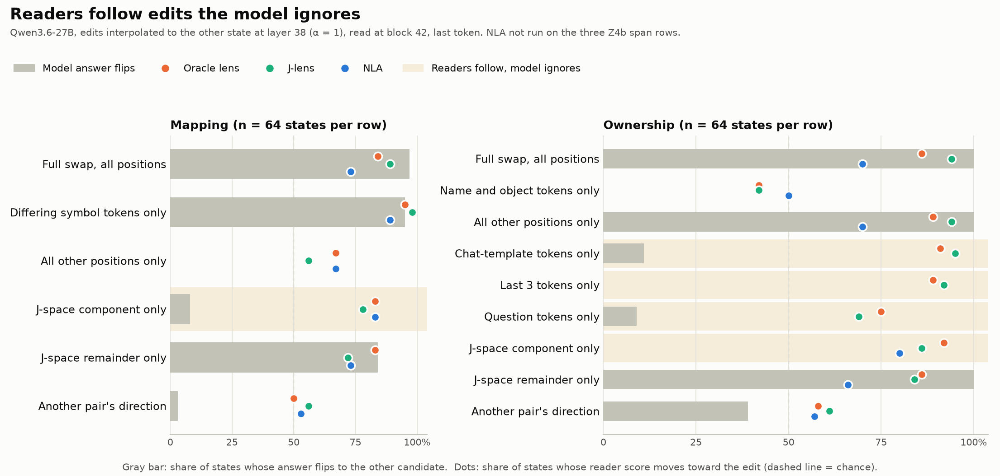

# Activation readers report what is in the vector, not what the model uses

Guiv Farmanfarmaian and Suraj · Qwen3.6-27B · updated 2026-10-09 (supersedes the 2026-10-08 version, kept as
`summary_for_agam_v1_2026-10-08.md`). Full record: `writeup.md`; pre-registrations `BRIEF_X/Y/Z.md`.

**Question.** Neel asked whether interpretability readers can be cross-referenced, and whether their agreement can
serve as ground truth. We grade each reader against facts established without readers: a fact built into the prompt,
a fact planted into the activation and confirmed by the model's own answer flipping, or the model's own behaviour.
Readers: J-lens, Oracle lens, NLA, plus a skip lens, an R-lens, a sparse autoencoder and linear probes. All are scored
by their own log-odds, not by parsing free text.

**Headline.** We edit the hidden state at layer 38 and ask two questions: does the model's answer flip, and does each
reader's score move toward the edit. Wherever the model's answer depends on the edit, the readers follow. But the
readers also follow edits the model ignores, often just as strongly:

| edit at layer 38 (64 states each) | model answer flips | readers move toward the edit |
|---|---|---|
| top-384 J-space component of the swap | 0–8% | 78–92% |
| ownership, last 3 tokens only | 0% | 89–92% |
| ownership, chat-template tokens only | 11% | 91–95% |
| full swap, all positions (reference) | 97–100% | 70–94% |

A reader's score tells you what is linearly present at its read site, not whether the model will act on it. Agreement
between readers inherits the same limit.

**Supporting results**
- **The readers behave as one instrument.** Scored natively, all three carry bindings that their free text never
  named (ownership/mapping: J-lens 85/94%, Oracle 83/87%, NLA 72/72%). On the model's own errors they pick the same
  wrong answer about twice as often as independent readers would (ratio 2.05, CI 1.70 to 2.43).
- **Majority agreement is not ground truth, but the strong version of that claim did not survive.** Majorities are
  right only where each reader is already right. The earlier "majority ranking inverts the true ranking" (Spearman
  −0.8) falls to −0.2 once candidate bias is counterbalanced, so we now call it suggestive.
- **Intervention prediction.** The readers differ only in one direction: NLA trails Oracle and J-lens, which are
  equivalent to each other. None of them predicts the model's answer flips better than simply knowing the edit's dose.
- **Where the answer lives.** Mapping carries it jointly on its two differing symbol tokens. In ownership the binding
  sits on the name tokens at layer 20, has left them by layer 28, and at layer 38 is spread over the whole span after
  the statements, with no part enough on its own.
- **The one place something beats the readers.** On 297 puzzles the model gets wrong, a probe reads the model's
  upcoming wrong answer at the last token from layer 48 (79%; 92% by layer 52). The readers at that site do not: J-lens
  41%, Oracle 49%, both on their own training layers, and NLA 57%, transferred from layer 42.
- **Other reader families.** The agreement-filtered skip lens passes our entry bar (89/83%) and behaves like the
  others. The disagreement-trained skip lens and the R-lens fall below it. The only available SAE was trained on
  Qwen3.5-27B and does not reconstruct Qwen3.6 states (variance explained below zero), so SAEs are untested here.

**Caveats.** Synthetic prompts with rule-based keys; one model; reads at the last token. "Inert" means within ±3.3 nats
at the last-token site, not exactly zero. The J-space split uses one rank (384) of one basis.

**Next, and why**
1. Read at layer 48 with readers trained there. That is the only site where the model's off-text answer is
   present and the readers miss it.
2. Fit one learned direction at layer 38, as the Gemma task-preference project did. Test whether the readers follow
   it, and whether it explains the J-space component they follow but the model ignores.
3. Use an off-text fact with a behavioural key, such as disguised hardcoding in the cheating setup another scholar
   ran on this model. Ask whether any reader reports it.

**Questions for you**
- Should a reader be judged only at its training site, or wherever the fact is load-bearing?
- Is "follows an edit the model ignores" a reader failure, or the correct report of a vector the model happens not
  to use?
- Which definition of "non-workspace" would you accept: J-space complement at a fixed rank, or behavioural?
