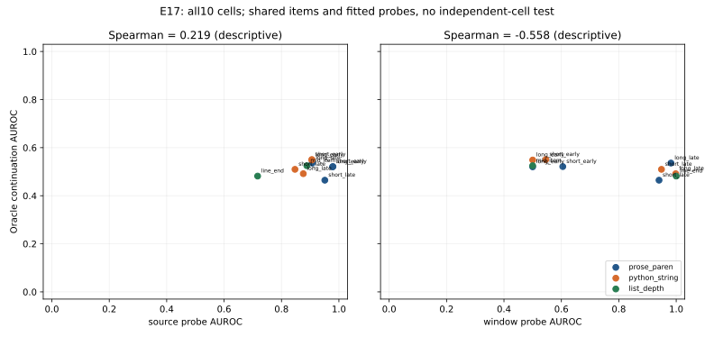

**Prediction (§110):** Oracle native continuation readability rises when the real next16 tokens reveal structure: both late span cells outperform early-long by≥0.10, and list line-end outperforms mid-item by≥0.10, while source-probe differences stay within±0.05. The window channel follows the lens and asked AUROC stays≤0.60 in every cell.

**Assessment:** The prediction did not hold.

EXPLORATORY. Both E15 pairs are used unchanged. Logistic probes train only on pooled dev cells; all reported AUROCs use held-out template families. CIs use2,000 paired item-cluster resamples, shared across cells. Holm controls the three row-level positive-direction comparisons. The0.10 effect and0.05 flatness criteria apply to point estimates; source flatness is not a formal equivalence result. Window contrasts are descriptive; no new magnitude or significance threshold was added.

| Row / cell | Source probe | Next16 AR probe | Oracle continuation | Asked | Random continuation | Opposite continuation |
|---|---|---|---|---|---|---|
| prose_paren / short_early | 0.979 [0.958,0.996] | 0.605 [0.554,0.663] | 0.521 [0.462,0.579] | 0.454 [0.395,0.516] | 0.534 [0.449,0.611] | 0.479 [0.421,0.538] |
| prose_paren / short_late | 0.951 [0.918,0.979] | 0.940 [0.902,0.973] | 0.465 [0.425,0.502] | 0.447 [0.408,0.481] | 0.479 [0.388,0.564] | 0.535 [0.498,0.575] |
| prose_paren / long_early | 0.978 [0.956,0.995] | 0.500 [0.500,0.500] | 0.520 [0.462,0.579] | 0.452 [0.396,0.513] | 0.505 [0.417,0.592] | 0.480 [0.421,0.538] |
| prose_paren / long_late | 0.907 [0.863,0.949] | 0.982 [0.966,0.994] | 0.536 [0.492,0.587] | 0.519 [0.480,0.562] | 0.484 [0.406,0.571] | 0.464 [0.413,0.508] |
| python_string / short_early | 0.906 [0.864,0.948] | 0.546 [0.519,0.581] | 0.551 [0.497,0.610] | 0.572 [0.525,0.631] | 0.515 [0.436,0.593] | 0.449 [0.390,0.503] |
| python_string / short_late | 0.847 [0.808,0.894] | 0.949 [0.917,0.977] | 0.510 [0.485,0.538] | 0.493 [0.454,0.530] | 0.530 [0.457,0.602] | 0.490 [0.462,0.515] |
| python_string / long_early | 0.906 [0.864,0.948] | 0.500 [0.500,0.500] | 0.549 [0.494,0.609] | 0.569 [0.522,0.628] | 0.430 [0.351,0.509] | 0.451 [0.391,0.506] |
| python_string / long_late | 0.876 [0.831,0.925] | 0.998 [0.994,1.000] | 0.492 [0.469,0.514] | 0.474 [0.435,0.505] | 0.508 [0.411,0.600] | 0.508 [0.486,0.531] |
| list_depth / mid_item | 0.888 [0.838,0.939] | 0.500 [0.500,0.500] | 0.525 [0.507,0.550] | 0.480 [0.442,0.515] | 0.458 [0.369,0.540] | 0.475 [0.450,0.493] |
| list_depth / line_end | 0.717 [0.682,0.762] | 1.000 [1.000,1.000] | 0.482 [0.457,0.503] | 0.439 [0.398,0.468] | 0.503 [0.416,0.594] | 0.518 [0.497,0.543] |

| Row / contrast | Lens Δ [95% CI] | Source Δ [95% CI] | Window Δ [95% CI] | Row Holm p | Direction held |
|---|---|---|---|---:|---|
| prose_paren / short_late−long_early | -0.056 [-0.125,+0.010] | -0.027 [-0.065,+0.008] | +0.440 [+0.402,+0.473] | 1.00000 | False |
| prose_paren / long_late−long_early | +0.016 [-0.060,+0.096] | -0.071 [-0.120,-0.026] | +0.482 [+0.466,+0.494] | 1.00000 | False |
| python_string / short_late−long_early | -0.039 [-0.098,+0.018] | -0.059 [-0.113,-0.003] | +0.449 [+0.417,+0.477] | 1.00000 | False |
| python_string / long_late−long_early | -0.057 [-0.123,+0.004] | -0.030 [-0.092,+0.034] | +0.498 [+0.494,+0.500] | 1.00000 | False |
| list_depth / line_end−mid_item | -0.043 [-0.075,-0.019] | -0.171 [-0.227,-0.108] | +0.500 [+0.500,+0.500] | 1.00000 | False |

Every continuation pair and asked phrasing, all three arms, their CIs, true−random contrasts, and each cell are retained in `metrics.json`; dev/test membership and fitted parameters are retained separately. Controls remain signed against recipient truth and never cause a post-hoc exclusion.

The list stimulus uses a shared2-space root offset: current/next items at2 versus6 spaces are top/third level. E15’s unchanged2-versus4-space candidates remain an inherited shallow/deep proxy. Neutral Python twins are outside-string lexical controls and are not promised to be valid executable programs. No result establishes spontaneous generation, and the across-cell correlation is descriptive only.
